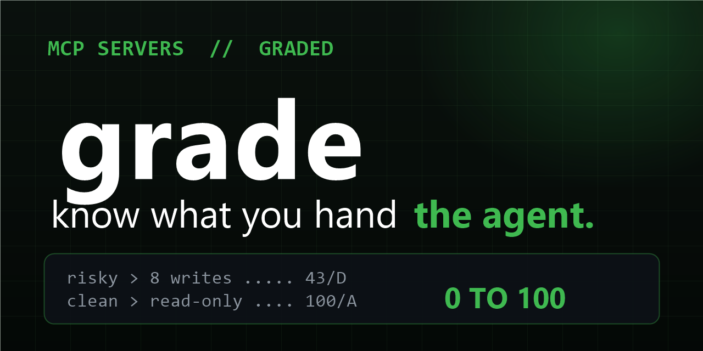

# Grade — deterministic 0–100 score for MCP servers



[](LICENSE)
[](https://github.com/Figo-star/grade/stargazers)
[](https://github.com/Figo-star/grade/commits/master)

**How much authority are you handing your agent — and how much of it is declared?** Grade scores any MCP config with fixed rules, no LLM in the decision path. Same rules, every server, every time.

```
$ node bin/grade.mjs mcp.json
grade: 43/100 (D) — 7 finding(s)
  CRITICAL G1 [god-mode] live secret baked into config
  HIGH     G3 [god-mode] write-implying tool: push_files (no side-effect declared)
  MEDIUM   G4 [god-mode] unbounded string param: push_files.path
  ...
```

## The 30-second version

- **5 rules**: baked-in secrets (G1) · remote-code stdio (G2) · undeclared write tools (G3) · unbounded string params (G4) · credential env passthrough (G5).
- **Why these**: the MCP wire format has no "this mutates state" field, so `get_file_contents` and `create_or_update_file` look identical to the model. Grade measures exactly that gap — the same gap behind CVE-2025-54136 and the rug-pull attack class.
- **Exit codes**: `0` ≥60 · `1` 30–59 · `2` <30. Gate new servers in CI.
- **`--json`** for pipelines and dashboards.

## Install

Zero deps, Node 18+. Nothing to install:

```bash
git clone https://github.com/Figo-star/grade.git
cd grade
node bin/grade.mjs <your-mcp.json>
node bin/grade.mjs fixtures/clean-mcp.json   # expect 100/A
node bin/grade.mjs fixtures/risky-mcp.json   # expect 43/D
```

Drop `SKILL.md` into your agent: every new MCP server gets graded pre-connect, <60 needs your explicit approval.

## Pairs with

[sniff](https://github.com/Figo-star/sniff) scans skills + configs for malware and prompt-injection. Grade scores authority hygiene. Run both: sniff says *is it malicious*, grade says *how much damage could it do*.

## Honest limits

Heuristics, not proof: name-based write detection can miss exotic verbs and flag benign ones; unbounded strings are a surface, not a vulnerability. Scores compare servers, they don't certify them.

## License

MIT — see [LICENSE](LICENSE).
